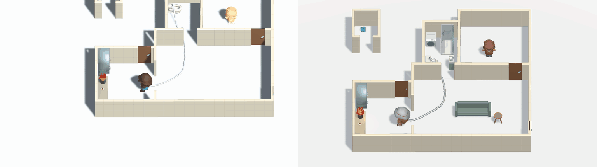

# 炎上消防隊 v0.3.1

## 下載方法

[下載 Windows x64 ZIP](https://github.com/xin-hw/Enjo-Fire-Brigade/releases/download/v0.3.1/FireRescue-v0.3.1-Windows-x64.zip)，完整解壓縮後執行 `FireRescue.exe`

## 操作

| 按鍵 | 功能 |
| --- | --- |
| WASD | 移動 |
| 滑鼠 | 瞄準 |
| 左鍵 | 裝備斧頭／揮砍 |
| 右鍵 | 裝備噴槍／接管／噴射 |
| E | 接管／拔管、拿放／交付布丁 |
| R | 重新開始 |

## 與 v0.3 的差異

左邊是 v0.3，右邊是 v0.3.1

- v0.3 的水是透明的，這版改成藍色色塊和深藍描邊，水噴到哪、地上積了多少都比較好看清楚
- 管子沿用 Unity 物理引擎，空曠的地方收得更快，碰到門角會先放慢
- 火和地上的灰燼改成卡通色塊
- 火被牆擋住時，會在牆面顯示一圈細線框
- 蘇打粉改成奶油色，打到東西會揚起粉塵
- 換了主角和受困者的模型
- 客廳換了家具
- 浴室重新擺過
- 第一關改成固定視角
- 重新打光，陰影比之前柔和
- 布丁可以站遠一點按 E 拿
