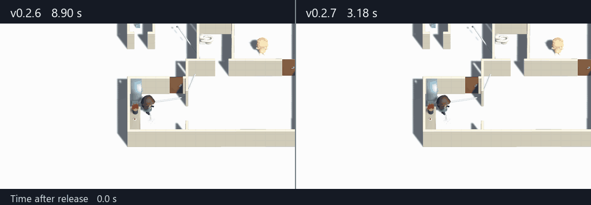

# 炎上消防隊 v0.2.7

## 下載方法

[下載 Windows x64 ZIP](https://github.com/xin-hw/Enjo-Fire-Brigade/releases/download/v0.2.7-prototype/FireRescue-v0.2.7-Windows-x64.zip)，完整解壓縮後執行 `FireRescue.exe`。

## 操作

| 按鍵 | 功能 |
| --- | --- |
| WASD | 移動 |
| 滑鼠 | 瞄準 |
| 左鍵 | 裝備斧頭／揮砍 |
| 右鍵 | 裝備噴槍／接管／噴射 |
| E | 接管／拔管、拿放／交付布丁 |
| R | 重新開始 |

## 與 v0.2.6 的差異

- 10 公尺收管約快三倍。同一路線實測 **8.90 秒 → 3.18 秒**。
- 保留緩起步與末段減速，轉角受阻時會放慢。

