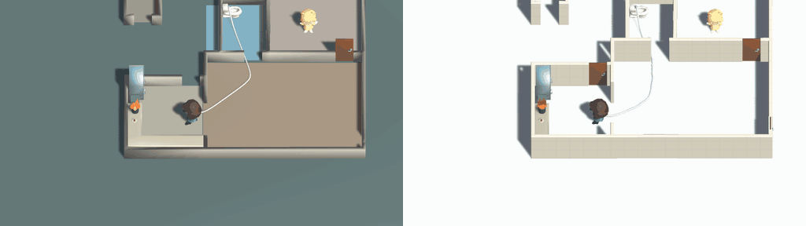

# 炎上消防隊 v0.3

## 下載方法

[下載 Windows x64 ZIP](https://github.com/xin-hw/Enjo-Fire-Brigade/releases/download/v0.3/FireRescue-v0.3-Windows-x64.zip)，完整解壓縮後執行 `FireRescue.exe`

## 操作

| 按鍵 | 功能 |
| --- | --- |
| WASD | 移動 |
| 滑鼠 | 瞄準 |
| 左鍵 | 裝備斧頭／揮砍 |
| 右鍵 | 裝備噴槍／接管／噴射 |
| E | 接管／拔管、拿放／交付布丁 |
| R | 重新開始 |

## 與 v0.2.1 的差異

左邊是 v0.2.1，右邊是 v0.3

之前的水是用程式生成五道簡單的水滴效果，滑鼠只能改方向，沒辦法控制噴多遠

這次把水改成透明，現在會往玩家右鍵點的位置噴，水滴打到地板或檯面後會留下積水（之後可能會改成淺藍色，再加一圈外圍描邊）

管子也是，以前是用程式模擬的，走到轉角容易卡住玩家，現在管子已經改用 Unity 物理引擎，也加了收管動畫，拔管或拉脫後會捲回角色身上

場景暫時改成白色地板和米色牆面，這樣比較容易看清楚水和管子的效果

修正了拿出消防斧和消防噴槍時的持握動作

現在角色站著不動時也會看向滑鼠的位置

### 下版預計改善

火的部分目前正在研究好看的做法中！

布丁和室內模型也會再調整
